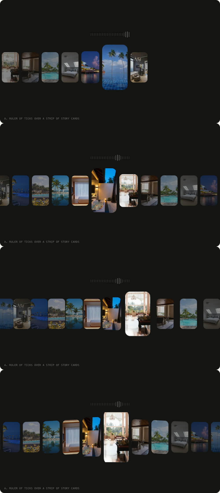
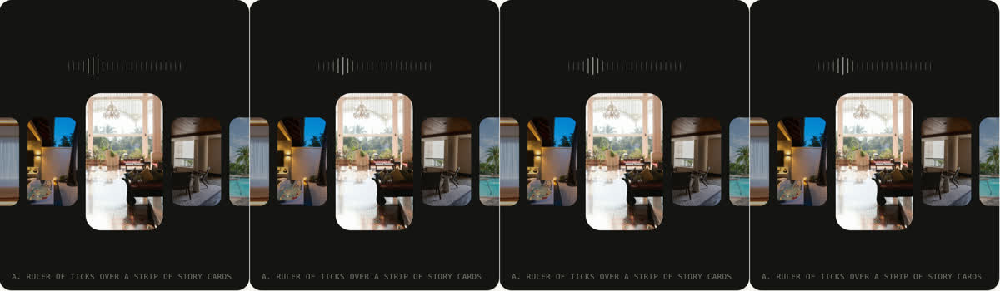

# What makes the reference strip feel fluid

Studied 11 Nov 2026 in Chromium (Metal GPU), recorded at 60 fps with the DevTools screencast while dragging slowly, flinging and turning the wheel. The speed and height of the strip were then measured frame by frame (a row of pixels matched between frames for the shift; the topmost card edge for the height). Ideas only: none of its code or pictures go into frankaa. The reference grabs below stay local (they are git-ignored).

## Findings

1. **Damped follow, not a spring.** After a fling the speed falls by a steady ratio, about 7% per frame: 28, 26, 24, 23, 20, 19, 19, 16, 15, 13 px/frame and so on down to 0 over about a second, with no overshoot. That is a position easing toward a target every frame (a lerp with a constant factor, roughly 1 - e^(-4.5 t)), not a critically damped spring.
2. **The strip trails the pointer.** While dragging, the strip does not move 1:1: it ramps up over about 25 frames and moves at roughly half the pointer's speed, so it always lags a little behind the hand. Grabbing it mid-glide takes over smoothly from where it is.
3. **Speed bends the strip.** It is drawn on a canvas (WebGL), and the whole row deforms with speed: at the fling's peak (about 1700 px/s) the cards near the middle grow taller (the top edge rises 23 px, so about 16% taller) and the tops and bottoms trace a curve, as if the strip were a sheet bulging toward you. It flattens back as the speed dies, frame by frame with the speed. At a slow drag (about 300 px/s) the lift is only 5 to 8 px.
4. **Focus colours the pictures.** Pictures near the pointer or the middle are in colour; the rest are grey and darker. The colour follows the focus as it moves.
5. **Not seen:** no blur, no per-card chain delay (the cards keep their spacing; the whole sheet bends together), and no obvious parallax of the picture inside its card at these speeds.

## In the mockup

The panel has a new **Fluid** switch:

- **Off:** the frankaa spring (critically damped, 1:1 under the finger).
- **Lerp:** findings 1 and 2: the position eases toward its target every frame (faster while held, so the strip trails the finger a touch), and a fling decays smoothly with no overshoot.
- **Chain:** our own variation: every card eases toward the strip at its own rate, nearer the middle first, so the row stretches and gathers like a chain.
- **Bend:** lerp plus finding 3: speed lifts the strip into a bulge around the middle, and each card takes the slope of the bulge (skewed and stretched), so the tops and bottoms trace a curve; it flattens as the strip slows. It is done with transforms in the DOM, without WebGL.

Presets: A uses Bend, B uses Chain, C uses Lerp. Every mode respects reduced motion (it jumps instead).

Finding 4 (colour by focus) is not in the mockup yet; it is a small addition (a grey and dim filter that lifts near the focus) if the owner wants it.
